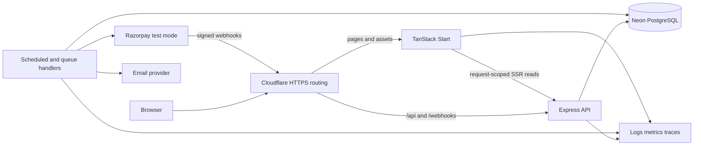

# KwikBus architecture

## Architectural choice

Use a **modular monolith on Cloudflare Workers**: Express handles synchronous API requests through Cloudflare’s supported Node HTTP adapter. Scheduled/queue-triggered Worker handlers run bounded background work using the same backend modules and Neon database. TanStack Start renders the web interface in a separate Worker and calls the API through a service binding. There is no persistent Node server or background polling process in deployment. Node 24 is the local build/migration toolchain, not the production runtime. This runtime decision was specified by the user after the initial design.

TanStack Start already provides server capabilities. Here, its server execution is limited to rendering, request-scoped API reads, and session propagation. Express remains the sole authority for business commands, authorization, prices, inventory, and provider integration. This preserves the requested backend rather than creating two competing implementations. See [Start's execution model](https://tanstack.com/start/latest/docs/framework/react/guide/execution-model).



The arrows show data flow, not separate business services. API and scheduled/queue handlers use the same booking policies and repository functions. Service bindings keep API calls within Cloudflare; browser requests stay on one public origin.

## Stack and version policy

- TypeScript in strict mode, ECMAScript modules, pnpm workspaces, Turborepo task graph.
- TanStack Start/Router for rendering, typed routes, search parameters, and navigation. TanStack Query for server-state fetching and mutation lifecycle. No second global copy of booking state in a client store.
- React form state and a schema-based form library when needed; shared Zod DTO validation. Accessible headless primitives and a small UI package; select styling libraries during the compatibility spike.
- Express 5 on Workers through `cloudflare:node` `httpServerHandler`; Node 24 LTS for tooling only. The official release page listed Node 24 as LTS and Node 26 as Current at research time; pin a maintained LTS patch when scaffolding. [Node release policy](https://nodejs.org/en/about/previous-releases).
- Drizzle with `drizzle-orm/neon-serverless` and `@neondatabase/serverless` WebSocket pools for interactive transactions. Create, use, and close a pool inside each Worker invocation; never share a connected pool across requests. Use a pooled Neon URL for runtime work and a direct URL with `pg` for migrations. The HTTP-only Neon driver cannot replace interactive booking transactions. [Drizzle and Neon](https://orm.drizzle.team/docs/connect-neon).
- Better Auth with a Drizzle adapter and verified-email magic links, subject to the initial compatibility/security spike. Mount auth before general JSON parsing. [Express integration](https://better-auth.com/docs/integrations/express).
- Vitest for policies/services, real PostgreSQL integration tests, Playwright for browser flows, and k6 for repeatable load/contention runs.
- Postgres-backed inbox/outbox/job tables, structured JSON logs, OpenTelemetry, and a hosted error/metrics destination chosen at deployment.

Pin compatible stable releases in the lockfile. Record exact versions, Node patch, PostgreSQL major, and hosting configuration in the eventual benchmark manifest. Documentation examples that use `@rc` are not a reason to adopt prereleases.

## Proposed repository

```text
apps/
  web/                     TanStack Start routes, features, query options, UI
  api/                     Express bootstrap, middleware order, HTTP lifecycle
  jobs/                    Scheduled/queue Worker entrypoints; no persistent loop
packages/
  backend/
    src/modules/
      identity/            Auth adapter and authorization
      catalog/             Cities, templates, and draft catalog
      booking/             Published trip browsing, inventory, money workflow
        payments/          Provider adapter and reconciliation
      notifications/       Delivery handlers
      operations/          Admin composition and audit queries
  db/                      Server-only Drizzle schema, migrations, pool
  contracts/               Client-safe DTO schemas, API client, error codes
  ui/                      Reused accessible presentation components
  config/                  Shared TS/lint tooling; typed runtime config separately
tests/
  integration/             PostgreSQL transactions and HTTP contracts
  e2e/                     Browser journeys and accessibility checks
  load/                    k6 scenarios and raw result manifests
docs/                      Product, architecture, decisions, operations
tasks/                     Build plan and task checklist
infra/                     Containers, ingress, deployment configuration
```

Create packages only as they become useful. Do not put source code into `apps/api` and import it from `apps/jobs`; both consume `packages/backend`. Keep fixtures/test helpers out of runtime exports.

Enforce dependency rules in lint/CI: web imports contracts/UI/config only; contracts imports no backend/DB code; backend modules use public module interfaces; no application imports another application. A repository is not modular merely because it has many folders.

## Request and transaction boundaries

HTTP middleware establishes request ID, validated session, input validation, authorization, rate limits, and consistent error mapping. A command service opens one Drizzle transaction, passes its `tx` explicitly through repositories, writes business state and outbox messages, and commits. Response serialization happens after commit.

The booking module owns all mutations of published inventory. Every allocation, expiry, capture finalization, cancellation, and sale-state change takes the same trip row lock. This deliberately serializes writes for one bus departure, while unrelated trips proceed independently. It is a measured simplification for a 40-seat portfolio product, with a clear contention limit; [correctness protocols](booking-correctness.md) define it precisely.

No external HTTP/email/payment request is made while holding database locks. Network side effects start from a committed operation intent. Transactions are short and retryable only when their database outcome is known or recovered through the same idempotency key.

## Web rendering, sessions, and caching

- One public origin. Ingress routes `/api/*` and `/webhooks/*` to Express and other paths to Start.
- SSR loaders call Express over the private service network. Forward only necessary session/correlation headers. Do not trust browser-supplied user headers or broad header forwarding.
- One QueryClient per SSR request; dehydrate only authorized data. Never put a shared QueryClient or a request's cookies in module scope.
- Use route search schemas for origin/date/filter/sort state. Query keys include all result-affecting inputs. Cancel stale reads, invalidate affected data after mutation, and refetch on focus/reconnection.
- Public city/catalog responses may have explicit cache policies. Search availability and seat maps begin uncached across shared intermediaries; add caching only with measured need and a stated staleness budget.
- Booking, session, admin, and payment responses use `Cache-Control: private, no-store`. Clear sensitive query caches on logout and do not persist them to local storage.
- The timer uses `serverTime` plus `expiresAt`; refresh after focus/resume. Client clock and countdown never authorize payment or confirmation.
- Optimism is limited to visual selection. A seat becomes reserved only after the server accepts the hold.

## Worker and durable messaging

Use PostgreSQL as the durable queue at the initial scale. A worker claims small batches with `FOR UPDATE SKIP LOCKED`, records a lease token/expiry, commits, and then processes work. Completion is conditional on the lease token. Retry transient errors with exponential backoff and jitter; move exhausted work into a visible review state.

The outbox is written in the same transaction as booking transitions. A dispatcher creates jobs with a unique `(event_id, handler)` key and marks dispatch in one transaction. Jobs, payment observations, and delivery handlers are idempotent. This is at-least-once processing; no claim of globally exactly-once email or payment delivery.

Scheduled work includes expired-hold scans, payment reconciliation, refund reconciliation, stuck-operation detection, job retries, and retention cleanup. Polling is adequate. Neon transaction pooling does not support session-dependent features such as `LISTEN/NOTIFY` or session advisory locks; do not build correctness on them. [Neon pooling limitations](https://neon.com/docs/connect/connection-pooling).

## Deployment and environment design

Cloudflare Workers is the required backend deployment target. Express uses `httpServerHandler`; `app.listen()` registers a virtual Node HTTP server for the adapter, not a public TCP listener. Verify the configured compatibility date against the pinned Wrangler/workerd version. See [Cloudflare Express support](https://developers.cloudflare.com/workers/tutorials/deploy-an-express-app/).

The web Worker uses the Cloudflare Vite adapter for Start, with an `API` service binding. `/api/*` routes proxy to the API Worker; SSR calls the same binding with only the required session/correlation headers. Web never imports the backend or database packages. This also exercises the production runtime in local development.

Neon is in Singapore for this development project. Each API/scheduled/queue invocation opens a bounded WebSocket pool, executes its complete interactive transaction on the same checked-out client, and closes the pool before the invocation ends. Do not use global connected clients, filesystem persistence, process signals, or server-held timers for correctness. [Neon edge connection lifecycle](https://neon.com/docs/serverless/serverless-driver#pool-and-client-usage-notes).

Use Cron Triggers to scan durable Postgres work in bounded batches. Add Cloudflare Queues for low-latency delivery where useful, keeping the outbox as the durable source of undispatched work and handlers idempotent. `waitUntil()` may finish bounded cleanup; it is not a replacement for a durable queue. Design for invocation CPU/subrequest/wall-time limits, with small batches and DB lock deadlines. No long-running provider polling loops.

Wrangler secrets hold runtime credentials; migrations run in a separate Node CI job using the direct database URL. Keep test, preview, and live environments separate. The current development project is free/synthetic; its default branch name is not an indication that live commerce is enabled. Production DML-only role, email delivery, custom-domain routing, secret provisioning, and remote deployment remain release gates.

Build and dry-run both Workers, run migrations once, deploy the API before the bound web Worker, and run browser smoke checks against the actual deployment. Retain rollback versions; use expand/contract migrations. Check Workers account limits and measured database latency before promising availability or throughput. Smart Placement/region hints are optimizations to evaluate after measuring; they do not replace database serialization.

## Alternatives and when to reconsider

| Decision | Why now | Revisit trigger |
|---|---|---|
| Trip-level serialization | Simple proof for multi-seat atomicity and lifecycle races | Measured same-trip lock latency exceeds budget |
| Postgres job queue | Transactional handoff without another critical datastore | Queue volume or isolation needs measurably hurt OLTP |
| Full-trip allocation | A small, comprehensible first release | Real need to sell A→B and B→C independently |
| Separate Start and Express Workers | Keeps SSR and business authorization distinct through a service binding | Measured simplification without duplicated business logic |
| Fixed published fares | Stable accepted quote and easy reconciliation | Product requires dynamic price versions |
| No Redis inventory lock | PostgreSQL already owns transactions and uniqueness | Cache/rate-limit needs may justify Redis, never as the only seat guard |

Before optimizing the lock scheme, measure contention, write a new correctness argument, and retain the same fault tests. Replacing the row lock with Redis or an in-memory mutex would weaken the existing guarantee.
