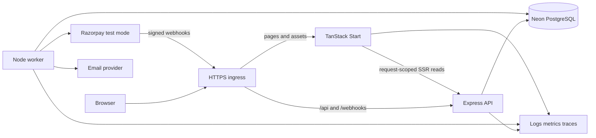

# QuickBus architecture

## Architectural choice

Use a **modular monolith with two backend runtimes**: a synchronous Express API and a durable Node worker, sharing the same backend modules and Neon database. TanStack Start runs as the web server for rendering and UI routing. This gives clear ownership, atomic booking updates, and independent worker recovery without distributed transactions between services.

TanStack Start already provides server capabilities. Here, its server execution is limited to rendering, request-scoped API reads, and session propagation. Express remains the sole authority for business commands, authorization, prices, inventory, and provider integration. This preserves the requested backend rather than creating two competing implementations. See [Start's execution model](https://tanstack.com/start/latest/docs/framework/react/guide/execution-model).



The arrows show data flow, not separate business services. API and worker use the same booking policies and repository functions.

## Stack and version policy

- TypeScript in strict mode, ECMAScript modules, pnpm workspaces, Turborepo task graph.
- TanStack Start/Router for rendering, typed routes, search parameters, and navigation. TanStack Query for server-state fetching and mutation lifecycle. No second global copy of booking state in a client store.
- React form state and a schema-based form library when needed; shared Zod DTO validation. Accessible headless primitives and a small UI package; select styling libraries during the compatibility spike.
- Express 5, Node 24 LTS as the initial runtime candidate. The official release page listed Node 24 as LTS and Node 26 as Current at research time; pin a maintained LTS patch when scaffolding. [Node release policy](https://nodejs.org/en/about/previous-releases).
- Drizzle with `drizzle-orm/node-postgres` and a `pg.Pool` for interactive transactions. Neon pooled URL for application traffic; direct URL for migrations and backup tooling. Drizzle's documented driver choices support this serverful arrangement. [Drizzle and Neon](https://orm.drizzle.team/docs/connect-neon).
- Better Auth with a Drizzle adapter and verified-email magic links, subject to the initial compatibility/security spike. Mount auth before general JSON parsing. [Express integration](https://better-auth.com/docs/integrations/express).
- Vitest for policies/services, real PostgreSQL integration tests, Playwright for browser flows, and k6 for repeatable load/contention runs.
- Postgres-backed inbox/outbox/job tables, structured JSON logs, OpenTelemetry, and a hosted error/metrics destination chosen at deployment.

Pin compatible stable releases in the lockfile. Record exact versions, Node patch, PostgreSQL major, and hosting configuration in the eventual benchmark manifest. Documentation examples that use `@rc` are not a reason to adopt prereleases.

## Proposed repository

```text
apps/
  web/                     TanStack Start routes, features, query options, UI
  api/                     Express bootstrap, middleware order, HTTP lifecycle
  worker/                  Job runners, schedules, shutdown, health heartbeat
packages/
  backend/
    src/modules/
      identity/            Auth adapter and authorization
      catalog/             Cities, templates, and draft catalog
      booking/             Published trip browsing, inventory, money workflow
        payments/          Provider adapter and reconciliation
      notifications/       Delivery handlers
      operations/          Admin composition and audit queries
  db/                      Server-only Drizzle schema, migrations, pool
  contracts/               Client-safe DTO schemas, API client, error codes
  ui/                      Reused accessible presentation components
  config/                  Shared TS/lint tooling; typed runtime config separately
tests/
  integration/             PostgreSQL transactions and HTTP contracts
  e2e/                     Browser journeys and accessibility checks
  load/                    k6 scenarios and raw result manifests
docs/                      Product, architecture, decisions, operations
tasks/                     Build plan and task checklist
infra/                     Containers, ingress, deployment configuration
```

Create packages only as they become useful. Do not put source code into `apps/api` and import it from `apps/worker`; both consume `packages/backend`. Keep fixtures/test helpers out of runtime exports.

Enforce dependency rules in lint/CI: web imports contracts/UI/config only; contracts imports no backend/DB code; backend modules use public module interfaces; no application imports another application. A repository is not modular merely because it has many folders.

## Request and transaction boundaries

HTTP middleware establishes request ID, validated session, input validation, authorization, rate limits, and consistent error mapping. A command service opens one Drizzle transaction, passes its `tx` explicitly through repositories, writes business state and outbox messages, and commits. Response serialization happens after commit.

The booking module owns all mutations of published inventory. Every allocation, expiry, capture finalization, cancellation, and sale-state change takes the same trip row lock. This deliberately serializes writes for one bus departure, while unrelated trips proceed independently. It is a measured simplification for a 40-seat portfolio product, with a clear contention limit; [correctness protocols](booking-correctness.md) define it precisely.

No external HTTP/email/payment request is made while holding database locks. Network side effects start from a committed operation intent. Transactions are short and retryable only when their database outcome is known or recovered through the same idempotency key.

## Web rendering, sessions, and caching

- One public origin. Ingress routes `/api/*` and `/webhooks/*` to Express and other paths to Start.
- SSR loaders call Express over the private service network. Forward only necessary session/correlation headers. Do not trust browser-supplied user headers or broad header forwarding.
- One QueryClient per SSR request; dehydrate only authorized data. Never put a shared QueryClient or a request's cookies in module scope.
- Use route search schemas for origin/date/filter/sort state. Query keys include all result-affecting inputs. Cancel stale reads, invalidate affected data after mutation, and refetch on focus/reconnection.
- Public city/catalog responses may have explicit cache policies. Search availability and seat maps begin uncached across shared intermediaries; add caching only with measured need and a stated staleness budget.
- Booking, session, admin, and payment responses use `Cache-Control: private, no-store`. Clear sensitive query caches on logout and do not persist them to local storage.
- The timer uses `serverTime` plus `expiresAt`; refresh after focus/resume. Client clock and countdown never authorize payment or confirmation.
- Optimism is limited to visual selection. A seat becomes reserved only after the server accepts the hold.

## Worker and durable messaging

Use PostgreSQL as the durable queue at the initial scale. A worker claims small batches with `FOR UPDATE SKIP LOCKED`, records a lease token/expiry, commits, and then processes work. Completion is conditional on the lease token. Retry transient errors with exponential backoff and jitter; move exhausted work into a visible review state.

The outbox is written in the same transaction as booking transitions. A dispatcher creates jobs with a unique `(event_id, handler)` key and marks dispatch in one transaction. Jobs, payment observations, and delivery handlers are idempotent. This is at-least-once processing; no claim of globally exactly-once email or payment delivery.

Scheduled work includes expired-hold scans, payment reconciliation, refund reconciliation, stuck-operation detection, job retries, and retention cleanup. Polling is adequate. Neon transaction pooling does not support session-dependent features such as `LISTEN/NOTIFY` or session advisory locks; do not build correctness on them. [Neon pooling limitations](https://neon.com/docs/connect/connection-pooling).

## Deployment and environment design

The first deployment can use a small Linux VM running Docker Compose: Caddy for TLS/path routing, separate web/API/worker containers, and external Neon. This is a concrete, low-service-count topology with one public origin. Run non-root app containers, health checks, restart policies, bounded resources, and secrets supplied at runtime. The worker is never a public HTTP service.

This topology has a single-host failure domain. It can demonstrate disciplined deployment but does not justify a high-availability claim. If the availability objective or operating preference requires it, move the same three app images to managed containers with replicated web/API and managed ingress. The concurrency design must already pass a two-API-instance test before horizontal scaling.

Place compute near the chosen Neon region after a latency measurement. Use separate Neon projects/credentials for production and staging where available; disposable branches for previews contain synthetic data only. No preview may inherit live payment/email secrets or production customer data.

Build immutable images in CI, run one separately authorized migration job with the direct DB URL, deploy compatible API/worker/web versions, check health, then run a sandbox smoke journey. Roll back images for compatible schema changes; use forward repair for destructive data changes. Keep the last known-good release available.

## Alternatives and when to reconsider

| Decision | Why now | Revisit trigger |
|---|---|---|
| Trip-level serialization | Simple proof for multi-seat atomicity and lifecycle races | Measured same-trip lock latency exceeds budget |
| Postgres job queue | Transactional handoff without another critical datastore | Queue volume or isolation needs measurably hurt OLTP |
| Full-trip allocation | A small, comprehensible first release | Real need to sell A→B and B→C independently |
| Separate Start and Express servers | Retains frontend framework and explicit backend ownership | Deployment evidence supports a simpler shared adapter |
| Fixed published fares | Stable accepted quote and easy reconciliation | Product requires dynamic price versions |
| No Redis inventory lock | PostgreSQL already owns transactions and uniqueness | Cache/rate-limit needs may justify Redis, never as the only seat guard |

Before optimizing the lock scheme, measure contention, write a new correctness argument, and retain the same fault tests. Replacing the row lock with Redis or an in-memory mutex would weaken the existing guarantee.
