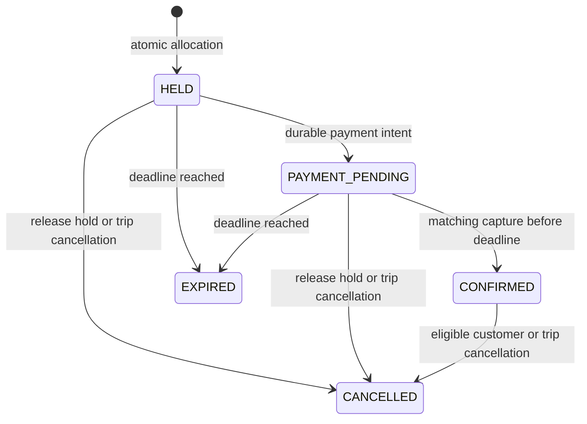

# Booking and payment correctness

## Guarantees and limits

The design protects these properties within KwikBus's authoritative inventory:

1. A seat has at most one current allocation for a trip.
2. A party receives all requested seats or none.
3. Confirmation requires matching verified captured money and ownership of every unexpired allocated seat.
4. Every observed capture is either used once for fulfillment, compensated, or assigned a visible reconciliation case.
5. Retried commands/events do not repeat their business effect within the documented replay horizon.
6. Refund processing cannot restore inventory or revive a cancelled booking.

No distributed system can guarantee instantaneous progress while its database or provider is unavailable. Safety remains mandatory; liveness resumes through retries/reconciliation or explicit review. “Exactly once” describes a guarded local transition, not universal message delivery.

## State models

Bookings never transition from `EXPIRED/CANCELLED` back to `CONFIRMED`. Payment failure does not change the booking to a terminal state while its hold remains live; it remains `PAYMENT_PENDING` and may explicitly start another checkout attempt after authoritative failure checks.

Each checkout attempt has `PENDING → CREATING → READY`, with `UNKNOWN` for ambiguous outcomes, `FAILED` for authoritative terminal failure, and `CAPTURED` for a successful payment observation. Payment attempts separately record `AUTHORIZED/FAILED/CAPTURED`. Capture is sticky: older failure/authorization events cannot downgrade it. The logical intent is unique per booking and may contain several sequential checkout attempts. Refunds use `PENDING/PROCESSING/UNKNOWN/PROCESSED/NEEDS_REVIEW`; after a reported refund failure, reconcile provider truth before deciding whether any new refund request is safe.

## One lock protocol

Every mutation of a published trip's booking/inventory/payment business state follows:

1. Claim the HTTP idempotency key when applicable; admission quota checks occur before trip locks.
2. Lock the trip row with `SELECT ... FOR UPDATE`.
3. Lock affected booking rows in ID order, then payment/refund rows in ID order when needed.
4. Read `clock_timestamp()` **after acquiring the lock** and recheck state, deadline, ownership, quote, and sale/cancellation rules.
5. Write allocations, booking/payment transitions, events, audit, outbox, and command result atomically.
6. Commit before any network side effect.

Use PostgreSQL `READ COMMITTED` with this shared protocol and constraints. `now()` is fixed at transaction start, so it is unsuitable for a deadline check after waiting for a lock. Do not hold an old snapshot or authorize using the pre-lock browser/request time. PostgreSQL's [locking](https://www.postgresql.org/docs/current/explicit-locking.html) and [isolation documentation](https://www.postgresql.org/docs/current/transaction-iso.html) support the mechanisms; this particular protocol is our design.

All writers, including workers and admin commands, must obey the protocol. A job-claim transaction ends before business processing starts, so job locks never sit above trip locks. A batch touching multiple trips processes one trip per transaction; it does not lock a collection in arbitrary order.

Start with a 2-second lock timeout and a 5-second statement/transaction budget, tune from measurements, and keep external calls out. Lock timeout returns `RESOURCE_BUSY` with a retry hint and the same command key. Deadlocks/serialization failures may retry the whole pure-DB transaction at most three times with jitter and a total request deadline. A lost commit acknowledgment is an unknown outcome: recover with the same key, not an unkeyed rerun.

The coarse lock is intentional. It handles a small departure's entire lifecycle with a short, auditable critical section. Different trip IDs do not block one another. A unique seat key additionally rejects accidental duplicate inserts even if an implementation path misses a read check. Benchmark same-trip contention before considering finer locks.

## Atomic hold

`POST /api/v1/holds` receives the trip, exact seat labels, selected stops, expected displayed fare, and a stable client key. The server does not trust the displayed fare.

Inside the command transaction:

1. Acquire the trip lock and DB time. Require an open, published, future departure, valid party size, valid pickup/drop, and enough remaining hold time.
2. Retire expired pending bookings for this trip: mark them `EXPIRED`, delete only their allocations, append events, and enqueue reconciliation for any payment intent. This keeps correctness independent of the expiry worker.
3. Reject a second live booking for this customer/trip; return a link to the existing reservation. Replaying its own key returns its original result.
4. Read every requested `trip_seats` row and current allocation. Require the exact distinct seat set, matching accepted fare, and no existing current claim. If any fails, allocate none.
5. Create the booking and immutable quote, insert historical items, then insert current allocations. Set `expires_at = min(db_time + 10 minutes, sales_close_at)`.
6. Persist the response and an audit/domain event; commit.

Do not use `ON CONFLICT DO NOTHING` and accept a smaller row count. A group booking must fail atomically. Price mismatch returns a fresh quote for explicit user acceptance, not a silently changed charge.

## Expiry and sale closure

The expiry scheduler finds candidate trip IDs using the due index, then processes one trip transaction at a time. It rechecks deadlines under the lock; stale candidate lists do no harm. A seat-map read may treat a pending booking past deadline as logically available before cleanup runs, since the next hold transaction will retire it before claiming the seat.

Sales closure blocks new holds. Existing holds may finish until their existing capped deadlines. Trip cancellation blocks both new holds and confirmation immediately. Neither an expired browser tab nor a stopped worker can extend a hold.

### Expiry versus capture race

- If finalization wins the trip lock, sees a live hold before expiry, and commits confirmation, an expiry worker later observes `CONFIRMED` and does nothing.
- If expiry/reallocation wins, finalization observes `EXPIRED`, missing ownership, or a new allocation and creates a compensation intent. It never steals the replacement customer's seat.
- At exactly `expires_at`, expiry wins semantically: eligibility is `db_time < expires_at`.
- A provider timestamp before expiry does not let a late event reclaim released inventory. Our strict policy evaluates the local finalization point, explains the consequence to the customer, and refunds late captures.

## HTTP idempotency

The browser creates one UUID per user intent and reuses it across automatic retries, double clicks, and recovery. It persists the non-secret key/resource ID across reload; passenger data and session tokens are not stored with it. A deliberately new intent gets a new key.

Scope uniqueness by authenticated principal, HTTP method, route template, and key. Canonical request hashing includes normalized body, route resource IDs, and relevant version/precondition headers. Reusing a key with a different request returns `422 IDEMPOTENCY_KEY_REUSED`.

For a pure database command, insert the key, perform the mutation, and store its result **in the same transaction**. A concurrent identical insert waits on the unique key; after commit it replays the result. If the bounded wait expires, return `409 IDEMPOTENCY_IN_PROGRESS` or `RESOURCE_BUSY` and let the caller retry the same key. Never let a second execution through because the first looks old. Rollback leaves no half-claimed committed command record.

Persist deterministic business-conflict outcomes when the key was claimed, so the same attempt does not later acquire different seats. A user changing the seat set makes a new intent/key. Uncommitted infrastructure failures do not persist a fabricated success/failure result.

Keep complete replay responses 30 days and a hash/resource tombstone at least 180 days, longer than the maximum supported automated replay window. An aged tombstone returns `409 IDEMPOTENCY_RESULT_EXPIRED` and the authorized resource location; it does not execute again. Never purge an unresolved intent. Financial object IDs and unique business keys survive worker/DLQ replays beyond HTTP response retention.

## Payment initiation without an open transaction

Preparing payment validates all names, verified contact email, stop selections, policy acceptance, and booking version. Under the trip lock, freeze these details, create the unique local payment intent and its first checkout attempt, move to `PAYMENT_PENDING`, and write an outbox event. Return `202` with a status location. No provider call has happened yet. A later explicit retry creates a sequential checkout attempt only after the previous attempt is authoritatively failed and no provider payment remains unresolved. Use a partial unique index to allow at most one unresolved checkout attempt per intent.

The worker takes the trip lock, checks that the attempt has not already started and the booking is still eligible, marks the durable operation `CREATING`, and commits. It then calls Razorpay to create an order with the immutable amount/currency, partial payment disabled, and a deterministic receipt derived from the checkout-attempt UUID (36 ASCII characters). On a known response, record the order ID under the same business lock protocol. Return hosted-checkout configuration only while the booking remains eligible with at least 90 seconds left. Repeated HTTP requests with the same key return the same checkout attempt, never another order.

**Provider contracts are endpoint-specific.** The current Razorpay create-order guide calls for a fresh order after a failed payment attempt and specifies unique receipts up to 40 characters. Its list endpoint exposes a receipt filter. Some other order-state descriptions still discuss multiple attempts on an order, so verify account/test-mode behavior rather than assuming order reuse. The conservative design creates a fresh order only for an explicit, safe new checkout attempt. [Create order](https://razorpay.com/docs/api/orders/create/), [list/filter orders](https://razorpay.com/docs/api/orders/fetch-all/).

The refund idempotency header is not an order-create header. Treat timeout/crash during creation as `UNKNOWN`; look up the same receipt, validate exact receipt/amount/currency/environment, and bind the existing order. A list response can use partial receipt matching, so filter exact matches locally and handle pagination. If lookup cannot establish one unique result, open a case and let the hold expire safely. An empty lookup is not proof that an in-flight create can be repeated. Verify receipt enforcement and visibility behavior in the provider spike. [Refund idempotency](https://razorpay.com/docs/api/refunds/normal-refunds-idempotent).

A new provider order is never the timeout recovery strategy. If the provider eventually reveals multiple objects, reconcile each independently and prohibit multiple fulfillment. For an authoritatively declined attempt with no unresolved authorization/capture, the customer may request a new attempt with a new key and receipt while the same hold remains live. Continue reconciling earlier attempts; a surprising later capture still obeys single fulfillment and excess-payment compensation.

## Webhooks, callbacks, and reconciliation

Mount the webhook route with a bounded raw body before `express.json()`. Validate its signature against the exact bytes using the correct environment secret. Signature failure gets a non-success response and no processing. For a valid supported event, insert into the durable inbox under a unique provider/environment/event ID, then acknowledge quickly. Database failure returns non-2xx so the provider can retry. Duplicate event IDs with the same hash are acknowledged; a changed payload for one ID opens a case.

Razorpay documents duplicate and out-of-order webhook delivery. Deduplication by event ID is necessary, but different event IDs can describe the same payment; also dedupe by payment identity and guarded state transition. [Webhook validation and ordering](https://razorpay.com/docs/webhooks/validate-test/).

A verified browser callback is a hint to schedule an authoritative provider fetch. Use the stored order ID to verify its signature and check ownership; never confirm from browser fields alone. Callback, webhook, and scheduled fetch feed the **same** `applyPaymentObservation` command.

Finalization obtains the trip lock, resolves the immutable intent/order/environment, validates captured status and exact amount/currency, and reads current booking/allocation state:

| Observation | Transaction result |
|---|---|
| Matching capture, live `PAYMENT_PENDING`, all seats still owned, trip not cancelled, time before expiry | Record capture; set payment reference and `CONFIRMED`; keep allocations; append one confirmation event/outbox message |
| Same capture observed again | No additional confirmation, refund, or notification event |
| Capture after expiry/release or customer/trip cancellation | Record capture; keep booking terminal; ensure one full-refund intent and outbox job |
| Additional captured payment for a booking already fulfilled by another payment | Do not fulfill twice; compensate the additional capture once |
| Failed/authorized attempt after a captured observation | Keep capture authoritative; do not downgrade |
| Matching failed attempt, hold still live | Record failure; allow an explicit new checkout attempt/order after unresolved-state checks |
| Amount/currency/order mismatch or unresolvable mapping | No fulfillment; persist protected evidence and an actionable case; compensate only after identity/amount are established |

Inbox `processed_at` and the business transition commit together. If a worker crashes after commit but before acknowledgment, a retry observes the already processed record or the semantic payment guard.

Reconcile unresolved orders/attempts periodically, including expired and cancelled bookings with provider exposure. Use backoff, provider rate limits, and bounded per-pass work. Healthy unresolved payments should be checked within a minute. After the initial automated retry window (proposed 30 days), unresolved cases stay visible and require owned follow-up rather than deletion. A missing webhook must not silently strand money.

## Cancellation, trip cancellation, and refunds

Customer cancellation locks the trip and booking, rechecks DB time and immutable cutoff policy, changes the booking to `CANCELLED`, deletes its allocations, and creates one full-refund intent for any captured payment. An unpaid cancellation releases inventory without manufacturing a refund. The response says cancellation is accepted and exposes refund status; it does not claim the bank has returned the money.

Trip cancellation first changes `trips.sales_state` to `CANCELLED` under the trip lock and emits a drain job. New holds and finalization immediately reject confirmation. The worker cancels outstanding bookings in bounded transactions. If capture and cancellation race, either confirmation happens first and is then cancelled/refunded, or cancellation happens first and the late capture is compensated. A reconciliation pass verifies that every affected booking has been drained.

Refund jobs submit the immutable full captured amount with a stable `X-Refund-Idempotency` value derived from `refund.id` (UUID text uses provider-allowed characters). Retrying uses the same body and key. Unknown results are fetched/retried within the provider's supported guarantees; after that guarantee's horizon, reconciliation/manual review precedes another request. Never generate a fresh key because the first request timed out.

The refund row is unique per payment attempt, and the API exposes no arbitrary amount endpoint. Webhook/fetch confirmation updates it monotonically to `PROCESSED`. Refund failures open cases and remain visible. Provider refund completion time is displayed as pending until confirmed, not promised by a local timer.

## Crash and race matrix

| Failure point | Durable evidence | Required recovery |
|---|---|---|
| API commits hold, response lost | Allocation + booking + idempotency result | Retry same key returns same booking/deadline |
| API dies before commit | No committed domain change | Retry safely |
| Provider creates order, worker dies before saving ID | Prewritten checkout attempt marked CREATING/UNKNOWN | Reconcile receipt/provider evidence; no blind create |
| Capture occurs, browser closes | Provider order/payment plus webhook or scheduled fetch | Common finalizer confirms or compensates |
| Duplicate/out-of-order events | Inbox unique IDs + payment unique ID | No repeated transition or state downgrade |
| Hold expires during bank authentication | Terminal booking and released allocation | Later capture creates one refund intent |
| Cancellation races capture | Shared trip lock and terminal-state rules | Cancel/refund safely in either ordering |
| Worker lease expires during a network call | Operation ID and lease token | New worker reconciles; stale completion cannot overwrite; provider key protects supported effects |
| Refund succeeds, response lost | Refund intent and stable provider key | Fetch/retry same intent; no second refund |
| Email provider times out | Delivery intent | Prefer provider idempotency; otherwise bounded duplicates possible and documented |
| Database unavailable on webhook | No acknowledged inbox record | Return failure; provider retry plus later reconciliation |

Do not use in-memory locks, a Redis TTL alone, a browser timer, or a periodic cleanup job as the authority for inventory. Do not describe a transactional outbox as an atomic transaction with a payment provider. The [verification plan](quality-and-operations.md) tests the guarantees and these failure windows explicitly.
