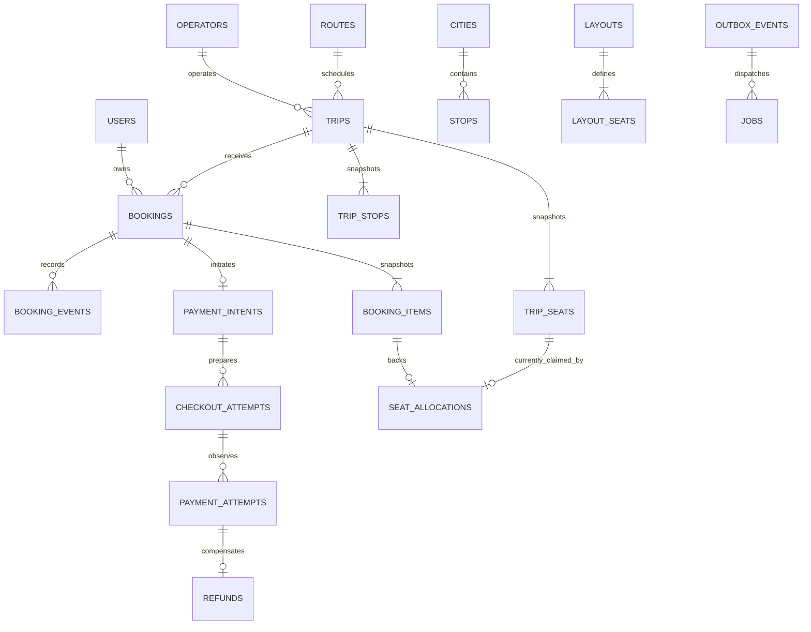

# KwikBus relational database design

This document includes the full target product and historical P1 baseline. Current Drizzle sources in `packages/db/src` implement catalog, bookings, sandbox payments and the customer lifecycle. The delivery record distinguishes implementation from deployed acceptance. [Task ledger](../tasks/todo.md).

## Current P1 schema

The P1 restore drill compared 26 tables including the migration ledger: six Better Auth tables, eight trip/booking/command tables, seven catalog tables, three inventory-definition tables and one maintenance heartbeat table. The presence of the auth library's two-factor table does not mean an admin MFA flow is exposed.

| Table / relationship | Current responsibility |
|---|---|
| `cities` / `city_aliases` / `operators` / `routes` | Stable catalog IDs, normalized alias keys and directional route uniqueness. Runtime read-only. Trip route/city references share a composite FK. |
| `layouts` / `layout_seats` / `stops` | Reusable 2+2 seat geometry and city-bound stop definitions. Owner tooling supplies synthetic definitions. |
| `inventory_service_stops` | Ordered pickup/drop definitions with departure-relative offsets. Publication validates endpoint cities, chronology, complete geometry and fares. |
| `inventory_services` | Persistent synthetic route/operator/vehicle/local departure, journey duration, sales lead and active flag; bounded fields and distinct cities. Owner tooling edits definitions. |
| `inventory_service_seats` | Service FK plus unique label and unique position, positive integer-paise fare; renewal validates a complete contiguous layout. Runtime can read, not edit. |
| `trips.source_service_id` | Nullable service FK for historical compatibility; unique `(source_service_id, departure_at)` makes concurrent renewal converge. Existing trips were adopted without replacing IDs. |
| `trips` → `trip_seats` / `trip_stops` | Published trip/seat/stop snapshots are inserted by one statement. Either snapshot-insert failure rolls back the whole publication. Trip-stop identity includes the trip; source stop/city references share a composite FK. Existing quotes and reservations are retained. |
| `bookings` → `booking_items` / `seat_allocations` | Immutable fare/seat history plus current unique allocation ownership. Selected stop FKs include the trip; passenger names and contact snapshots are nullable for legacy holds. Every hold/details/release/expiry mutation uses the same trip-row serialization lock and post-lock DB time. |
| `idempotency_keys` / `booking_events` | Command replay commits with the booking transaction. Event identity is unique `(booking_id,type,version)`; legacy lifecycle events use version 0, detail saves the new booking version. Expiry releases ownership atomically. |
| `maintenance_jobs` | `expiry` / `inventory` started/succeeded/failed timestamps and bounded aggregate processed counts; no job payload, user data or credential. |

Renewal materialises the next 30 India service days in batches of at most five missing departures. Expiry sweeps at most ten due trips, skips busy locks and retains lazy expiry as the correctness fallback. Owner tooling now fills normalized references and missing menus through bounded trip-locked backfill. Existing snapshots, quotes and customer choices are preserved. A separate mutable draft/admin authoring surface and paid-lifecycle policies remain future work. [P1 source and production evidence](p1-customer-journey.md). [Operational thresholds](operations.md), [schema/restore audit](recovery.md).

## Modeling principles

Use normalized relational tables for identity, inventory, bookings, and money. Use JSON only for bounded immutable snapshots, versioned event payloads, and validated provider evidence. Drizzle describes the schema and executes parameterized SQL; PostgreSQL constraints remain the final guard.

Current catalog/service identifiers are stable owner-managed text slugs; published trip/stop and reservation identifiers are UUIDs. Auth-library IDs retain their supported type. Other target transactional identifiers below are UUIDs generated by the application. IDs are opaque, not authorization secrets. Use a separately generated random booking reference with a unique constraint. Store times as `timestamptz`; store the trip's IANA timezone and local `service_date` explicitly. Use a single `Asia/Kolkata` timezone in v1. P1 date searches use a bounded `departure_at` range calculated in PostgreSQL for `Asia/Kolkata`, never the browser's implicit timezone; a stored service-date column remains a target modeling option.

Store expected INR amounts as positive integer paise: proposed v1 limits are 2,500,000 paise per seat and 10,000,000 paise per booking. API amounts are safe JSON integers within that bound. Never use binary floating point for fare arithmetic. Use `text` plus CHECK constraints for evolving business states, `NOT NULL` for required fields, and explicit `created_at`/`updated_at` where applicable. No cascade deletes for booking, payment, refund, or audit history.

## Entity relationships



The diagram omits auth and infrastructure edges for readability. `seat_allocations` is the current inventory claim; `booking_items` is permanent history. A released seat may appear in many historical bookings, but at most one current allocation.

## Catalog and publication tables

| Table | Important columns | Constraints and ownership |
|---|---|---|
| Auth tables | Library-generated user, session, account, verification, MFA tables | `identity` owns; use generated schema/migrations and documented token hashing; no custom password system |
| `user_roles` | `user_id`, `role` | FK to auth user; PK `(user_id, role)`; provisioning path only; no client role input |
| `cities` | `id`, `name`, `slug`, `timezone`, `is_active` | Unique slug; no destructive removal while referenced |
| `city_aliases` | `city_id`, `normalized_alias` | Unique alias/city pair; indexed alias for autocomplete; “Bangalore” can resolve to Bengaluru |
| `stops` | `id`, `city_id`, `name`, `address`, optional coordinates | FK city; index city; coordinates range checks if supplied |
| `operators` | `id`, `name`, `slug`, `is_active` | Unique slug; descriptive catalog, no supplier credentials |
| `routes` | `id`, `origin_city_id`, `destination_city_id`, `is_active` | Different origin/destination; directional route; unique pair in v1 |
| `layouts` | `id`, `name`, `version`, `is_archived` | Templates are versioned; published trips do not read mutable templates |
| `layout_seats` | `layout_id`, `label`, `deck`, `row`, `column`, `seat_type`, `is_window` | PK `(layout_id, label)`; unique layout/deck/row/column; v1 only seated positions |
| `draft_trips` | `id`, `route_id`, `operator_id`, `layout_id`, schedule/fare/stop configuration, `version` | Admin authoring; can be edited before publication; publication reference unique |
| `trips` | `id`, `draft_trip_id`, route/operator IDs, `origin_city_id`, `destination_city_id`, display-name snapshots, `service_date`, `timezone`, `departure_at`, `arrival_at`, `sales_close_at`, `sales_state`, `policy_snapshot`, `published_at`, `version` | Unique draft publication; arrival after departure; sales close before departure; `OPEN/CLOSED/CANCELLED/DEPARTED`; no editable published schedule |
| `trip_stops` | `id`, `trip_id`, source stop ID, `role`, `sequence`, `scheduled_at`, name/address snapshot | Unique `(trip_id,id)` and `(trip_id,sequence)`; role `PICKUP/DROP`; publication validates cities and chronological order |
| `trip_seats` | `trip_id`, `seat_label`, template/layout-position snapshot, `fare_minor`, `currency` | PK `(trip_id,seat_label)`; fare positive and bounded; currency `INR`; one row per published seat |

Publish in one transaction: claim command key → create trip snapshot → materialize all stops/seats → validate completeness → append audit/event → commit. A failure leaves no partially published inventory. Fleet-vehicle assignment is outside v1; layouts are reusable templates, not a physical bus schedule.

## Booking and allocation tables

| Table | Important columns | Constraints |
|---|---|---|
| `bookings` | `id`, `reference`, `trip_id`, `user_id`, `status`, `version`, `expires_at`, `quoted_at`, `total_minor`, `currency`, `boarding_stop_id`, `dropping_stop_id`, contact snapshot, itinerary/policy snapshots, `confirmed_payment_id`, confirmation/cancellation times/reason | Unique reference; unique `(id,trip_id)`; state `HELD/PAYMENT_PENDING/CONFIRMED/EXPIRED/CANCELLED`; exact state/time CHECKs; total >0; `CONFIRMED` requires payment reference; expiry retained for history |
| `booking_items` | `booking_id`, `trip_id`, `seat_label`, `passenger_name`, `fare_minor`, `currency`, seat snapshot | PK `(booking_id,seat_label)`; unique `(booking_id,trip_id,seat_label)`; composite FK `(booking_id,trip_id)` to booking; FK seat in same trip; name may be null until payment preparation |
| `seat_allocations` | `trip_id`, `seat_label`, `booking_id`, `allocated_at` | **PK `(trip_id,seat_label)`**; FK to trip seat; composite FK `(booking_id,trip_id,seat_label)` to booking item; current claims only |
| `booking_events` | `id`, `booking_id`, `sequence`, `event_type`, `from_status`, `to_status`, `actor_type`, actor/request/correlation IDs, timestamp, bounded payload | Unique `(booking_id,sequence)`; append-only history; no sensitive fields in event payload |

The database prevents cross-trip seat allocation through composite foreign keys. Boarding/drop FKs include `trip_id`; the service additionally checks their roles and timing while holding the trip lock. A FK alone cannot enforce pickup/drop semantics.

Enforce one pending reservation per user and trip with a partial unique index on `(trip_id,user_id)` for `HELD/PAYMENT_PENDING`. Retire that customer's expired reservation before a replacement. Do not place `now()` in an index predicate. Expiry is a state transition and cleanup is explicit.

Do not duplicate `available_seats` as authoritative mutable state. Derive availability from `trip_seats` minus effective live allocations. Search may use a later projection, but booking always reads the primary and acquires the mutation lock.

### Critical DDL shape

Illustrative migration design; this excerpt is not an executable full schema and has not been applied to PostgreSQL.

```sql
-- Parent columns and constraints must be created first.
ALTER TABLE bookings ADD CONSTRAINT booking_id_trip_unique
  UNIQUE (id, trip_id);

ALTER TABLE booking_items ADD CONSTRAINT booking_item_identity_unique
  UNIQUE (booking_id, trip_id, seat_label);

CREATE TABLE seat_allocations (
  trip_id uuid NOT NULL,
  seat_label text NOT NULL,
  booking_id uuid NOT NULL,
  allocated_at timestamptz NOT NULL DEFAULT now(),
  PRIMARY KEY (trip_id, seat_label),
  FOREIGN KEY (trip_id, seat_label)
    REFERENCES trip_seats (trip_id, seat_label),
  FOREIGN KEY (booking_id, trip_id, seat_label)
    REFERENCES booking_items (booking_id, trip_id, seat_label)
);

CREATE UNIQUE INDEX one_pending_booking_per_customer_trip
  ON bookings (trip_id, user_id)
  WHERE status IN ('HELD', 'PAYMENT_PENDING');

CREATE INDEX due_booking_expiry
  ON bookings (expires_at, trip_id, id)
  WHERE status IN ('HELD', 'PAYMENT_PENDING');
```

## Payments, refunds, and asynchronous work

| Table | Important columns | Constraints and purpose |
|---|---|---|
| `payment_intents` | `id`, `booking_id`, expected amount/currency, logical state `ACTIVE/SATISFIED/CLOSED`, timestamps | Unique booking; unique `(id,booking_id)` for composite FKs; one logical agreement, not one provider order; CLOSED intents still accept late observations for compensation |
| `checkout_attempts` | `id`, `intent_id`, `booking_id`, `attempt_number`, `provider`, `environment`, `receipt`, `provider_order_id`, `order_state`, operation token/times | Unique intent/attempt number; composite intent/booking FK; unique provider/environment/receipt and non-null order ID; unique `(id,booking_id)`; at most one unresolved attempt per intent |
| `payment_attempts` | `id`, `checkout_attempt_id`, `booking_id`, `provider`, `environment`, `provider_payment_id`, observed amount/currency, `status`, `captured_at`, `observation_source` | Unique provider/environment/payment ID; composite checkout-attempt/booking FK; unique `(id,booking_id)`; captured state is not downgraded by older failure events |
| `refunds` | `id`, `booking_id`, `payment_attempt_id`, `provider`, `environment`, `amount_minor`, `currency`, `reason`, `status`, `provider_refund_id`, `provider_key`, attempt/reconcile times | One **full refund per captured payment** in v1: unique payment attempt; unique provider key; unique provider/environment/refund ID; cross-booking FK protection |
| `webhook_inbox` | `id`, provider/environment/event ID, event type, encrypted or protected raw evidence, payload hash, received/processed times, processing status | Unique provider/environment/event ID; verified signature before insertion; bounded payload; duplicate with different hash quarantined |
| `idempotency_keys` | `principal_id`, `method`, `route_template`, `key`, canonical request hash, result status/body or resource reference, created/retention times | Unique principal/method/route/key; pure DB result stored atomically with mutation; no session/token material in result |
| `outbox_events` | `id`, aggregate ID/version, type, schema version, payload, created/dispatched times | Unique aggregate/version/type as appropriate; commit with domain change |
| `jobs` | `id`, event/handler key, job type, resource ID, due time, attempts, lease token/deadline, state, last safe error | Unique `(event_id,handler)`; partial index runnable jobs; no holding a DB transaction across network work |
| `notification_deliveries` | `id`, event ID, channel, template version, destination hash/reference, provider message ID, state, times | Unique `(event_id,channel,template_version)`; actual recipient fetched securely; email duplication is separately bounded |
| `reconciliation_cases` | `id`, kind, resource IDs, dedupe key, state, owner, safe summary, next action/time, resolution evidence | Unique dedupe key; unresolved cases remain visible; prevent duplicate cases from retries |
| `audit_log` | actor ID, action, target IDs, reason, request ID, outcome, timestamp | Append-only privileged-action trail; never store tokens or payment credentials |
| `rate_limit_buckets` | namespace, principal/IP hash, window, count, expires_at | Atomic upsert quota for security-sensitive endpoints if ingress cannot provide shared principal-aware limits |

Payment attempt observed currency/amount must be able to record a provider mismatch for investigation. Do not constrain observed currency to INR and thereby lose evidence; compare it with the immutable expected INR quote before fulfillment. A mismatch opens a case and cannot produce a ticket. Refund records preserve the actual captured currency/amount; unexpected-currency compensation requires operator review.

After creating payment tables, add a composite FK from `(bookings.confirmed_payment_id,bookings.id)` to `(payment_attempts.id,payment_attempts.booking_id)`. This prevents linking another booking's payment. The service enforces that the referenced payment is captured, matches amount/currency, and has not already been consumed. Keep the reference after confirmed-booking cancellation for financial history.

### Indexes driven by access patterns

- Trips: `(origin_city_id,destination_city_id,service_date,departure_at,id)` for open-sales search. Alternate sort indexes only after `EXPLAIN (ANALYZE,BUFFERS)` shows a need.
- Booking list: `(user_id,created_at DESC,id DESC)` for cursor pagination.
- Pending bookings within a trip: `(trip_id,expires_at,id)` with the same pending-state predicate, for lazy expiry retirement under the trip lock.
- Allocations: PK for contention/availability, plus `(booking_id)` for bulk release.
- Booking items/events: booking ID and event sequence.
- Checkout attempts: order-state/last-reconciled index for unresolved provider operations; partial unique intent index for states `PENDING/CREATING/READY/UNKNOWN`.
- Refunds: state/next-reconcile-time index for pending or unknown refunds.
- Inbox: unprocessed received time; jobs: runnable due time and leased deadline; outbox: undispatched created time.
- Audit/cases: target ID/time and open-state/next-action-time.

Index foreign keys used in joins or parent lifecycle operations. Avoid blanket indexes on every column, which increase write work without serving a query.

## Database versus service invariants

| Invariant | Enforcement |
|---|---|
| One current claim per trip/seat | Allocation primary key |
| Claim refers to a seat and item from the same trip | Composite FKs |
| One payment intent per booking | Unique booking ID |
| One observed provider payment/refund/event identity | Environment-scoped unique keys |
| At most one full refund intent per captured payment | Refund unique payment attempt |
| Same key cannot execute distinct requests | Idempotency unique claim plus canonical hash check |
| All requested seats allocated or none | One transaction plus trip lock |
| One to four items; sum of items equals quote | Service under trip lock; integration/invariant tests |
| Confirmed booking has exactly its allocated item set and matching captured money | Transaction protocol, composite payment FK, invariant audit |
| No allocations remain for terminal bookings | Same transaction releases claims; periodic audit detects violations |
| Total refunded never exceeds captured amount | Single full-refund policy, unique attempt, payment-row checks; no arbitrary refund amount endpoint |
| Valid times/roles, policy cutoff, allowed state transitions | Publish/booking services plus row CHECKs where row-local |

Ordinary CHECK constraints cannot query other tables. Do not claim that the ORM schema alone proves cross-row totals or legal transitions. A periodic invariant scan and adversarial integration tests complement the constraints.

## Migrations, privacy, and future segments

Generate and review Drizzle SQL migrations, commit them, and run them once through a serialized deployment job. Test both empty-database install and previous-release upgrade. Application credentials have scoped DML privileges only; append-only event/audit tables permit INSERT/SELECT but no routine UPDATE/DELETE. Separate migration and controlled retention roles own those exceptional operations. Avoid production `drizzle-kit push`. Use expand/backfill/contract for live schema changes, with indexes built using the appropriate online procedure and transaction restrictions verified during implementation.

Keep inventory/payment identifiers and dedupe evidence for the documented replay horizon. Purge raw webhook bodies and unnecessary PII earlier under an explicit retention job; never purge unresolved financial operations. Proposed demo defaults: raw provider evidence 30 days, operational logs 14 days, response bodies 30 days, idempotency tombstones at least 180 days. Financial/business retention requires a separate policy before real commerce; these defaults are not legal advice or statutory retention claims.

If segment selling is added, replace full-trip claims with explicit occupied legs and a unique `(trip_id,seat_label,leg_index)` key, inserting all legs of an itinerary atomically. Alternatively evaluate a range exclusion constraint. Define `[boarding_sequence,dropping_sequence)` occupancy, overlapping versus adjacent journeys, fare calculation, intermediate schedules, and cancellation release semantics first. Do not silently enable intermediate-city search against the current full-trip model.


## Customer lifecycle additions

Migrations0012–0015 add three tables and the immutable policy version; they retain
existing IDs, money, allocations and booking snapshots.

| Table | Key and authority |
|---|---|
| `booking_notifications` | UUID PK, booking FK, unique(booking_id,kind). Leased state/attempt/deadline/provider identity and request digest; no copied message or recipient. Runtime can insert/read and update delivery fields; it cannot delete history. Historical confirmations are explicitly SKIPPED. |
| `booking_cancellations` | Booking FK/PK; source CUSTOMER/TRIP, actor, policy version, accepted time and full refund quote. Runtime INSERT/SELECT only. A paid row must correspond to the cancelled booking's full compensation obligation; the independent audit checks the join. |
| `trip_cancellations` | Trip FK/PK; operator slug/reason/request time immutable. Runtime can advance only processed_bookings/completed_at. One TRIP_CANCEL job per trip resumes bounded batches. |
| `bookings.cancellation_policy_version` | Version1 is stored at creation and retains the existing two-hour rule. Later policy changes must preserve evaluation of version1. |

`booking_trip_status(trip_id,status,created_at,id)` supports bounded trip drain.
Existing unique payment/refund and booking-event identities remain the business
replay guard. New lifecycle events never update immutable fare/provider identity.
Cancellation releases current allocations but preserves passengers, selected stop
snapshots, original quote and history. The restore audit covers their linkage and
notification identity in addition to the prior financial/inventory checks.
