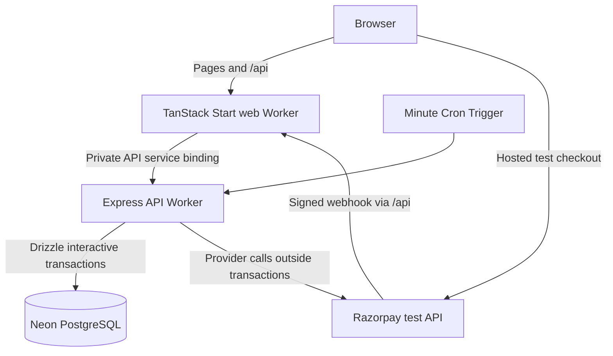

# KwikBus: seat ownership meets uncertain payments

KwikBus is a TypeScript bus-booking sandbox designed to demonstrate correctness under concurrent reservations and unreliable payment workflows. PostgreSQL inventory constraints, serialized booking transactions, durable payment attempts and authoritative provider reconciliation protect seat ownership and recover uncertain outcomes.

The central problem: a database transaction can allocate seats exclusively, but it cannot atomically commit a Razorpay operation. A successful browser response is therefore insufficient evidence for confirmation.

**Evidence baseline:** 27 October 2026, v0.2 test checkout. This account describes the implementation at [`ca7c3d0`](https://github.com/jackedengineer/quickbus/tree/ca7c3d04e748e07c79dc0479233a0969b3ff73c0), not every feature in the original architecture plan. Financial browser acceptance ran on `40077a1`; the final deployed revision was `74e06c2`, followed by documentation only. [Acceptance and revision lineage](payment-delivery.md#production-acceptance--27-october-2026), [final release record](evidence/payments-2026-10-27/release.json).

## Architecture that is implemented



The API Worker runs both HTTP handlers and bounded scheduled payment work using the same backend modules. PostgreSQL stores inventory, commands, payment records, inbox events and leased jobs. There is no separate deployed jobs service or Cloudflare Queue in this flow. Invocation-scoped Neon WebSocket pools support interactive transactions and close after use. [Worker entrypoint](../apps/api/src/index.ts), [web binding](../apps/web/wrangler.jsonc), [API configuration](../apps/api/wrangler.jsonc), [database client](../packages/db/src/client.ts).

## Decision 1: serialize each departure's mutations

`lockTrip` takes the trip row's `FOR UPDATE` lock, then reads `clock_timestamp()` and expires overdue holds. Reading time after the wait prevents a request from allocating against an already-passed deadline. The same lock coordinates holds, releases and payment finalization; unrelated trips have different lock rows. The implementation uses a two-second lock timeout and five-second statement timeout. [Command primitives](../packages/backend/src/commands.ts), [expiry](../packages/backend/src/expiry.ts).

A hold inserts the booking, every quoted item, every allocation, its event and the saved HTTP response in one transaction. There is no conflict-ignore insertion for seats: an allocation failure rolls back the whole party. The allocation primary key `(trip_id, seat_label)` enforces exclusivity; a composite foreign key binds each allocation to its booking item. The command key is scoped by customer and route, with a request hash: matching replays return the saved response, changed payloads are rejected. Seat labels are sorted before hashing. [Hold/release implementation](../packages/backend/src/booking.ts), [constraints](../packages/db/src/booking-schema.ts).

This deliberately favors an auditable critical section over maximum same-trip write throughput. SQL round trips remain inside the transaction; external provider calls do not.

## Decision 2: persist intent before crossing the payment boundary

Checkout checks ownership, saved details version, complete allocations and at least 90 seconds remaining after the trip lock. It persists a logical intent, a checkout attempt and recovery jobs before provider I/O. An unresolved attempt is resumed; a replacement requires authoritative failure rather than an SDK dismissal. [Checkout preparation](../packages/backend/src/payment-prepare.ts).

Order creation commits `CREATING` before its single provider POST. A lost response becomes `UNKNOWN`; recovery searches the exact receipt and validates money/identity. Zero matches remain inconclusive, and ambiguity opens a review case. It never blindly repeats order creation. This is grounded in the sandbox spike: two POSTs with the same receipt created different provider orders, initially absent from list reads. [Order worker](../packages/backend/src/payment-orders.ts), [reconciler](../packages/backend/src/payment-reconcile.ts), [dated provider observations and limits](provider-contract.md).

That choice sacrifices automatic progress when absence cannot be established. It avoids turning an uncertain operation into two independent orders.

## Decision 3: confirm or compensate using provider truth

Signed webhook intake verifies exact raw bytes and commits a deduplicated inbox record plus job before acknowledging. Processing fetches authoritative provider objects; signatures alone do not fulfill a booking. Webhook processing and reconciliation converge on `applyPaymentObservation`. Under the trip lock it checks provider mapping, amount/currency, captured status, the live deadline, every allocation and prior fulfillment. Older failure observations cannot downgrade capture. [Inbox](../packages/backend/src/payment-inbox.ts), [inbox worker](../packages/backend/src/payment-inbox-worker.ts), [shared finalizer](../packages/backend/src/payment-state.ts).

A matching capture confirms once while the booking still owns live seats. A late or additional matching capture instead creates compensation; it cannot revive a released reservation or take a seat from its new owner. Refunds retain one immutable UUID/body, submit once automatically, then recover uncertain outcomes through provider reads or review. The observed immediate same-key refund replay is not evidence of indefinite provider key retention. [Refund execution](../packages/backend/src/payment-refunds.ts), [provider contract](provider-contract.md#documented-contract-and-conservative-recovery).

Jobs use `SKIP LOCKED` claims and token/expiry-fenced completion. Minute cron recovery and request-triggered bounded work allow progress without an open checkout tab. This is retryable processing with guarded business transitions, not globally exactly-once delivery. [Job implementation](../packages/backend/src/payment-jobs.ts), [dispatch](../packages/backend/src/payment-worker.ts).

## Observed results, not service guarantees

| Experiment on 27 October | Recorded result | Interpretation |
|---|---|---|
| 100 last-seat customers, two independent Workers, Neon PostgreSQL 18 | One allocation; 99 final conflicts. Initially 93 busy responses and six unavailable responses; same-key recovery followed. Scenario elapsed: 71,385 ms. | Correct final ownership under this burst, not 100 immediate responses or a throughput benchmark. [Artifact](evidence/payments-2026-10-27/neon-contention.json) |
| Twelve concurrent requests with one command key; overlapping two-seat parties | One booking/event and two allocations for replay; one whole-party winner, zero partial parties. | Replay and atomicity evidence for these scenarios. [Artifact](evidence/payments-2026-10-27/neon-contention.json) |
| Actual desktop and 390×844 touch Chrome checkout | Bank Failure → explicit retry → capture → confirmation retained on reload. | Hosted test-mode acceptance; no live-bank or UPI result. [Record](evidence/payments-2026-10-27/production-acceptance.json) |
| Release before capture, original checkout tab offline | One processed ₹749 compensation refund; same-key provider replay returned the same ID and one refund total. Booking stayed cancelled, zero allocations/confirmation events. | Signed-event recovery worked in this controlled experiment without the browser verification callback. [Timeline](payment-delivery.md#production-acceptance--27-october-2026) |
| Independent SQL audit | Zero violations across 17 inventory/financial checks. | A snapshot audit, not absence of all possible bugs. [Results](evidence/payments-2026-10-27/production-acceptance.json), [queries](../scripts/recovery-audit.ts) |
| Consistent production snapshot restored to an isolated target | 33 tables / 7,613 rows; matching schema/counts/invariants; total drill 16,833 ms. | Production stayed online; no cutover, continuous backup, RPO or RTO established. [Record](evidence/payments-2026-10-27/recovery.json), [method](recovery.md) |

## Reproduce and inspect

Use the [README setup](../README.md#run-locally): pinned Node/pnpm, migrated and seeded disposable development database, restricted runtime role, owner connection for fixtures, and local Mailpit. Fixture tests require `DEPLOYMENT_ENV=local` and `ALLOW_DEV_FIXTURES=true`. Run `pnpm dev` and `pnpm dev:peer` in separate terminals, then:

```sh
pnpm test:integration
pnpm test:contention
```

The [contention harness](../scripts/prove-concurrency.ts) drains requests, audits independently and cleans up its fixtures; new results go to ignored `artifacts/local/`. These commands reproduce scenarios, not identical timings. The [CI workflow](../.github/workflows/ci.yml) instead provisions isolated PostgreSQL and two real Workers.

For fault-window review, start with [lost order response/empty lookup](../tests/integration/payment-order-recovery.test.ts), [capture/replay/reallocation](../tests/integration/payment-capture.test.ts), [lost refund response](../tests/integration/payment-refunds.test.ts), and [stale leases](../tests/integration/payment-jobs.test.ts). Provider fault tests stub network responses while exercising real database transitions; actual hosted checkout requires separate dedicated Razorpay test credentials and browser acceptance. The [payment delivery record](payment-delivery.md) supplies that historical evidence. The [restore runbook](recovery.md) documents the separately guarded drill.

## Tradeoffs and remaining scope

- **Modular monolith, two Workers:** one backend implementation keeps inventory and payment transitions together; web/API separation adds a binding/proxy boundary. It does not provide independent scaling or fault isolation for each business module.
- **Trip-level lock and PostgreSQL jobs:** simpler correctness and transactional handoff, with hot-trip contention and recovery work sharing the database. Measure lock latency and queue impact before introducing finer locks or another queue.
- **Limited synthetic catalog:** seeded cities/operators/routes and full-trip seat allocation make the proof tractable; segment resale and real operator inventory integration are outside this implementation. [Seed](../scripts/seed.ts), [inventory definitions](../packages/db/src/inventory.ts).
- **Test-only payments:** the adapter rejects live keys. Printable tickets, confirmation delivery, voluntary paid cancellation, trip cancellation and the admin dashboard remain incomplete. Compensation refunds are implemented; the full commercial lifecycle is not. [Adapter](../packages/backend/src/razorpay.ts), [task ledger](../tasks/todo.md).

The engineering contribution is the explicit boundary between exclusive database ownership and uncertain external money movement, supported by fault tests, real test-checkout observations and an audited restore—not a claim of production commerce readiness.
