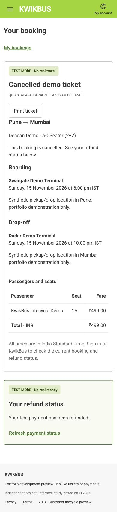

# Customer lifecycle delivery

Started 29 October 2026 from v0.2.0-preview. Complete the five accepted slices
sequentially. All customer inventory and lifecycle records live in PostgreSQL.
Razorpay stays test-only. No admin dashboard or public privileged mutation route.

1. **T22 — Retrieve and notify:** owned immutable booking snapshots, full-date
   printable demo ticket, durable confirmation delivery. Commit the notification
   intent with confirmation. Retain explicit pending/failure state; never equate
   an accepted email API request with recipient inbox delivery.
2. **T23 — Cancel:** preview and whole-booking command, recheck cutoff and state
   under the trip lock, immutable cancellation record, atomic seat release and
   unique full-refund intent. Retry the same request after response loss.
3. **T24 — Refund:** reuse the existing execution/reconciliation path for eligible
   paid cancellations; verify duplicate commands, missing browser callbacks,
   cancellation/capture ordering and real sandbox processed refunds.
4. **T25 — Cancel a trip:** trusted operator CLI only, immediate sales-state
   change, bounded resumable booking drain and progress audit. No customer-facing
   administrative endpoint. Record the operator/reason without logging contacts.
5. **T27–T29 — Accept and release:** normal and adversarial desktop/mobile usage,
   keyboard/print/focus/reduced motion, actual DevTools network/interaction traces,
   focused SQL fault/concurrency checks and isolated recovery/compatible rollback.

## Existing policy and boundaries

Whole-booking voluntary cancellation is available at least two hours before the
trip's first departure (including equality). Later cancellation is unavailable.
Trip cancellation before departure refunds captured fares regardless of that
customer cutoff. Cancellation commits before the bank refund completes; failure
must never resurrect seats. The existing booking reference is not an access token.
Ticket/history, cancellation preview and financial state require the verified
owner session and existing Origin protections.

## Notification contract

Use the existing Resend account and verified sender; no new provider. Confirmation
messages contain a booking reference and an authenticated page link, without
passenger names, phone numbers, payment details or session tokens. The event stores
only a booking reference, delivery identity/state and bounded processing evidence.
Use a stable key and identical message body for provider retries; stop uncertain
sends before the retention window expires. Do not replay old historical bookings
into customer inboxes during migration.

Resend retains email idempotency keys for 24 hours. Our automated retry deadline
must be shorter, not an exactly-once guarantee beyond that window. Local Mailpit
is a development inbox and does not supply Resend's duplicate suppression.
[Official provider contract](https://resend.com/docs/dashboard/emails/idempotency-keys).

## Evidence discipline

Keep roughly 300–400-line meaningful commits where the change naturally fits;
do not pad small fixes or combine unrelated changes. Browser acceptance leads;
written tests cover inaccessible crash/locking windows. Preserve private raw
traces and redact credentials, contact values, cookies and OTPs from evidence.
Record actual results per slice here before checking off its backlog acceptance.

## T22 ticket increment

The existing verified owner session opened My bookings → confirmed reservation
on the isolated localhost:3002 app. The ticket showed persisted passenger/seat/fare,
chosen stop addresses and the overnight arrival's full date. Confirmed review no
longer presents disabled passenger-edit fields. The ticket read is the same owned
single-statement snapshot as booking review; a focused real-Neon check verified
server-derived confirmation history and other-owner/missing-ID rejection.
Build, strict TypeScript and lint passed. The in-app print action blocked its
input automation until Escape; actual Chrome print acceptance remains pending.
Confirmation delivery, mobile/print and adversarial browser acceptance are still
required before completing T22. Private screenshot: artifacts/local/lifecycle/.

## T22 real journey and delivery

Source 648e0e4 passed exact-revision Quality 40900879803 (build and isolated
integration). A fresh isolated Chrome profile signed in through a delivered local
OTP, searched 30 October, chose stops/seat1A, saved a synthetic passenger and
completed the actual Razorpay mock-bank Success path. Capture confirmed once and
atomically queued one notification. The natural minute worker sent that message
to Mailpit; opening its link restored the owned ticket. Full reload retained the
ticket and SENT notice. No manual notification insert or fake session was used.
Mobile390px had no overflow; another owner's synthetic booking returned not-found
in the signed-in browser. Chrome's actual Print button responded; the native
preview layout remains a manual acceptance gap because native Mac control is
unavailable and headless Chrome exposes no preview. Production Resend acceptance
is deferred to the final guarded rollout, not inferred from Mailpit.
[Sanitized browser/SQL record](evidence/lifecycle-2026-10-29/tickets-email.json).

## T23 whole-booking cancellation

The command and preview use the immutable v1 two-hour rule, frozen as a booking
policy version against the published departure. Real Neon checks passed owner and
version rejection, concurrent same-key/different-key replay and a cutoff crossing
while waiting on the trip lock. The runtime can only insert/read cancellation
history. The provider call stays outside the trip transaction.

Actual Chrome desktop/mobile preview showed the full ₹749 test refund and the
30 October18:00IST deadline. Keep booking dismissed without mutation and returned
focus to the opener. Two tabs then submitted from their independently loaded
previews. The booking cancelled once, all allocations disappeared, and one
cancellation event, notification and refund intent remained. The UI retained the
cancelled ticket and separate refund progress. A discovered late-capture-specific
message was corrected for a formerly confirmed booking. Resource-busy/network
uncertainty preserves the request key and offers safe resume rather than claiming
failure or reverting the cancellation. Native print preview remains a separate
manual check; no cancellation/refund result is inferred from it.

## T24 cancellation refunds and recovery

The existing refund worker handles whole-booking cancellation without a second
execution path. Actual test payment pay_Ttm6geggcpMFER was fully refunded as
rfnd_TtmVxVJO9MYKIq. The cancellation committed at15:57:14UTC, the minute worker
started its refund33seconds later, and the provider/SQL state reached PROCESSED.
The mobile browser showed the cancelled ticket and processed refund; no browser
success hint or manual job execution was needed to run the refund.

Three further real-Neon fault scenarios passed: lost accepted-refund response
recovers by authoritative reads with one POST total; a fault after writing refund
intent rolls back money, seats, cancellation and command replay together; and an
additional captured attempt remains a separate full refund before/after customer
cancellation. Refund identities never merge or revive seats. The confirmed UI now
also surfaces additional-payment refunds and financial-review state instead of
hiding them behind the confirmed heading. Tests are scoped to their fixture job
IDs; they do not claim unrelated real sandbox work from the development queue.

## T25 trip cancellation

The trusted operator command is read-only unless explicitly given the database,
operator, reason and maximum affected count. Under the same trip lock as sales,
it refuses an unexpectedly larger audience, stops sales, records the immutable
request and enqueues one durable drain. Three bookings per transaction bound the
work; progress, cancellation history, allocations, notification and refund intents
commit together. Lease expiry rolls the whole batch back. The next minute worker
resumes without repeating a completed refund. Drain completion and bank-refund
completion are reported separately. No public privileged route or admin UI exists.

Two real-Neon scenarios passed: five bookings drain in two bounded batches with
one refund for the captured fare, and a stale invocation cannot commit while a
late capture is fully compensated. An unpaid drain works without provider keys.
The owned read exposes trip cancellation immediately; existing checkout admission
and finalization also recheck sales state under the trip lock. Open confirmed
bookings check status every15seconds while visible; terminal refunds retain their
existing bounded polling. Browser trip-cancellation acceptance is still pending.

## Native print acceptance

The user inspected Chrome's actual native preview for the persisted cancelled
demo ticket, confirmed that the layout fits correctly, and closed the dialog.
This closes the native-preview gap; local automated page controls cannot inspect
that operating-system surface. Public HTTPS acceptance remains a separate gate.

## T25 actual browser and scheduled recovery

A second normal customer journey selected the persisted 30 October20:00
Bengaluru→Hyderabad service, saved a synthetic traveller, and completed the real
hosted Razorpay mock-bank success. The browser restored the confirmed ticket and
its delivered confirmation email. The guarded local operator command reviewed
exactly one active booking, stopped sales and enqueued the trip drain.

The open browser updated to Trip cancelled before the booking drain completed;
its payment action disappeared. This exposed a conflicting voluntary-cancellation
control during the transition, now hidden for cancelled trips. The natural
minute worker completed one cancellation, released all allocations, sent its
cancellation email and processed the full ₹749 test refund. Actual payment
pay_Ttn2n6AevG65GO refunded as rfnd_Ttn9AAHMpO5uJH; no manual refund dispatch was
used. The 390px browser retained the cancelled ticket and processed refund after
reload. Drain and refund status were independently checked in PostgreSQL.

The new two-Worker Neon contention run also passed all nine scenarios: one winner,
99 resolved seat conflicts (94 initial bounded busy responses), atomic parties,
idempotent replay, post-lock time, rollback and independent allocation audit.
This is correctness evidence, not a throughput claim; the burst and retry phase
took84seconds. [Source-scoped record](evidence/lifecycle-2026-10-29/neon-contention.json).

## Browse performance investigation

The request-scoped pool deliberately has one connection. Catalogue Promise.all
therefore serialized three round trips, and search resolved aliases/date in two
separate preliminary reads. Return the coherent catalogue in one SQL statement
and combine search validation in one statement. No availability/session cache or
additional connection is introduced. Existing alias, date, cursor and capacity
checks still pass against the actual development database/API.

Twelve alternating restricted-role Neon calls before/after measured warm catalogue
~220–240ms → ~75–90ms and search ~225–255ms → ~150–185ms. A second after run retained
the reduction with some larger network outliers. The cold first call includes
connection setup. The100-read/concurrency5 local HTTP runs had zero failures but
noisy p95s (4772ms before /5423ms after); this is not evidence that HTTP tail
latency is fixed. Production/browser measurements are a separate release gate.
[All database samples and conditions](evidence/lifecycle-2026-10-29/database-performance.json).

## Pre-release review

Reviewed correctness, ownership/Origin boundaries, immutable financial evidence,
lease fencing, query behavior and maintainability across the stacked commits.
One remaining cancelled-trip window allowed an unpaid details edit while the
batch was pending; it now rejects under the trip lock, with a focused regression
check. There is one refund execution path and one email transport; no new
infrastructure dependency or admin API was added.

The mobile cancelled ticket and processed refund fit320px and390px without
horizontal overflow. Actual accessibility trees expose the passenger table,
headings, dialog controls and live refund status. Keep-booking focus restoration,
keyboard dialog dismissal, seat-list semantics and reduced-motion duration were
checked; the user verified native print preview. This is focused browser/AX
acceptance, not a formal WCAG certification or a physical screen-reader audio
review. Public HTTPS and production email verification remain release gates.

## Public HTTPS acceptance and preview release

The exact source 65748ac passed Quality CI and was deployed with additive
migrations 0012–0015. Fresh Google sign-in and actual public email OTP restored
owned reservations. An intentionally wrong OTP was rejected before the delivered
single-use code succeeded. Codes and credentials were kept out of public records.

A real public Pune→Mumbai journey used keyboard seat selection and persisted
stops/passenger details. Hosted provider cancellation produced a verified failed
attempt; explicit retry and mock-bank Success confirmed one booking. The actual
confirmation arrived in Gmail Inbox; its canonical authenticated link restored
the current persisted ticket. Two independent browser cancellation previews
showed the policy and full fare. Keep booking restored focus. Both cancellation
submits produced one history entry, one full INR499 refund and zero allocations.
Razorpay reported PROCESSED; the 390px ticket retained that result after reload.
The cancellation receipt also arrived in the real Inbox.

The guarded production trip command reviewed exactly one known synthetic unpaid
reservation, stopped sales and completed one worker drain with no remaining
allocations or outstanding refunds. The open mobile browser removed checkout
and showed Trip cancelled. A stale journey link then showed unavailable and no
search result. This production sample was unpaid; the paid trip-cancellation,
email and full refund proof used actual local Neon and hosted Razorpay earlier.
Release maintenance priming overlapped the production drain; do not attribute
that sample solely to scheduled Cron. Natural minute recovery was proved locally.

An exact-source disabled-checkout recovery API was deployed and restored. The
original deadline remained unchanged, recovery remained enabled and the cancelled
refunded ticket stayed usable. This exposed stale preparing-order copy when
admission was disabled; the final 15ac2de release explains the pause explicitly.
The final browser check visibly showed the pause explanation with no payment controls, followed by restoration of the enabled API. It includes the restore-target TCP readiness fix. No schema reversal, secret
replacement or production data restore was used.

The production restore compared 36 tables and 8,171 rows, matched schema/counts and
all 24 invariants, and completed in 22.9 seconds. Its disposable network-isolated
PostgreSQL target was removed. The encrypted archive remains private. This is a
portable restore proof, not continuous offsite backup or an RPO/RTO guarantee.
[Restore record](evidence/lifecycle-2026-10-29/recovery.json).

## Measured frontend/backend limits

The same short production search workload (100 reads, concurrency 5, seven dates)
had zero errors before/after. p50 changed 528→455ms, p95 changed 715→622ms;
after p99 was 1,126 ms and maximum 1,212 ms. This is not the planned sustained
50 requests/second or 10,000-trip capacity demonstration.

Chrome DevTools at 390×844, 4×CPU and Fast4G measured cold-home LCP 2,225→1,221ms,
TTFB 613→357ms and CLS 0. Results-page LCP was 1,252 ms with TTFB 486ms and CLS 0.
These are lab samples on a shared Mac, not field percentiles. Search interaction
improved 617→454ms but still misses 200 ms; map→list was 572 ms at 4×CPU, while
list→map was 42 ms at 1×CPU. Do not mark the low-end interaction gate complete.
No speculative caching or broad memoization was added to conceal these results.

The provider iframe intermittently remained blank in the existing Chrome
profile. The same persisted order loaded in the in-app browser; no duplicate
order or invented payment failure was introduced. Reload recovered the owned
reservation, and an abandoned order expired with zero allocations/no capture.
The root cause is unresolved; the successful earlier hosted payment does not
close this separate acceptance finding.

Focused security probes rejected wrong-Origin mutation (403), forged webhook
signature (401) and direct private API access (404); the old read host redirected
canonically (308). All 24 production financial/inventory/lifecycle invariants were
zero. Existing SQL fault/race checks and fresh two-Worker Neon contention add
correctness evidence. Exact source CI passed. Dependency audit has one existing
moderate development-only esbuild advisory through Drizzle Kit's unused serve
path, with no high/critical finding; no runtime service uses that dev server.

T22–T25 are complete for the sandbox scope. T27/T28 and the final product release
gate remain partial for throttled latency, physical screen-reader audio review,
sustained capacity and intermittent hosted-checkout loading. Admin remains
out of scope. [Versioned production record](evidence/lifecycle-2026-10-29/production.json).

## 31 October acceptance follow-up

The historical limits above remain part of the original v0.3 evidence. The next
patch adds bounded disposable checkout documents, app-owned Return, provider-check
reopen safeguards, responsive search feedback and stable seat rows. Fresh public
Google/OTP and actual hosted failure/retry/ticket/reload passed. Public throttled
search samples are 42/37/27ms, CLS0; the retained earlier cold misses are not hidden.

The full 15-minute, 10,000-trip/400,000-seat/100,000-history exercise was executed
and **failed** capacity acceptance. Runtime traces confirm free-tier CPU termination.
The user explicitly accepted a free limited-traffic preview and declined physical
VoiceOver audio review. No billing change or full conformance/capacity claim is
made. [Current record](acceptance-hardening.md), [load results](evidence/acceptance-2026-10-31/load.json),
[browser results](evidence/acceptance-2026-10-31/browser.json).
