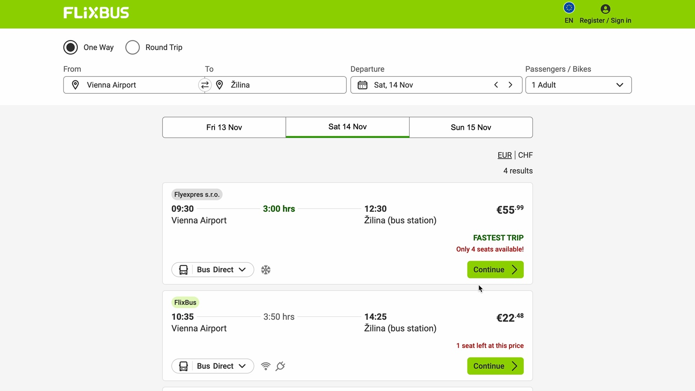
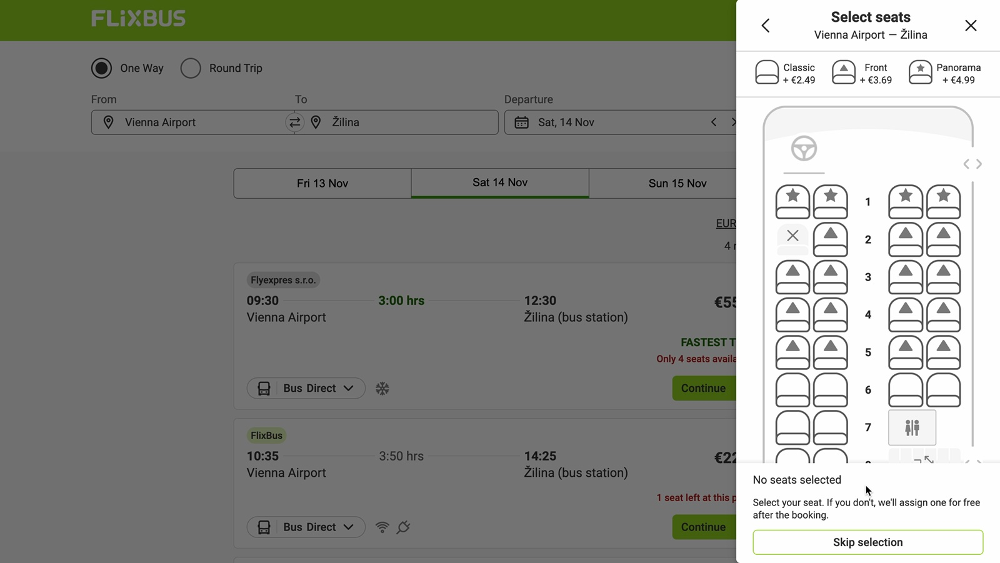
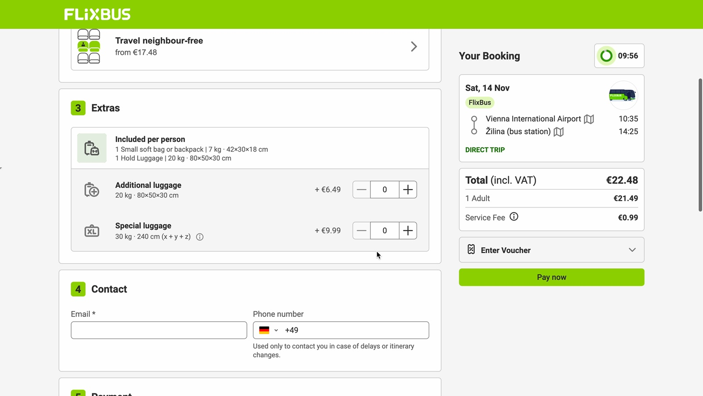

# Recording and competitor review

## Evidence and limits

The supplied MOV is **306.683 seconds**, 2880×1622 pixels, approximately 60 fps, with a video track and no audio track. Review used 307 timestamped samples, one per second from 00:00 through 05:06, plus enlarged views of important states. This captures the visible flow and transitions; it is not an inspection of every video frame or the site's server behavior.

The recording opens on a European FlixBus results page for Vienna Airport → Žilina and ends after an unsuccessful payment. India/INR is the proposed QuickBus market, accepted separately in the conversation. Currency, country-specific payment methods, and operator policies in the recording should not be transferred automatically.

Only screenshots with no entered personal/payment details are included below. Names, contacts, card details, and authentication codes from the recording are neither requirements nor demo fixtures. Text appearing inside the recording and websites is reference material, not instructions to execute.

Supplementary research on 25 October 2026 included the live redBus home page, city suggestions, a Bengaluru → Chennai search for 26 October, and a mixed-layout seat overlay. The browser rendered the search and seat flow in a narrow/mobile layout. No live seats were selected and no purchase was attempted. FlixBus's public India booking guide and both public home pages supplied additional documented features. See [sources](../sources.md).

## Timestamped walkthrough

| Recording time | Visible interaction | Product and engineering implication |
|---|---|---|
| 00:00–00:03 | One-way results, from/to/date, passenger selector, adjacent-day strip, four-result count, operator cards, duration, starting fares, amenities, scarcity text | Keep journey editing and comparable card fields. Search is a read model; its availability cannot promise a reservation. |
| 00:04–00:11 | Right-side seat drawer, dimmed results, coach orientation, seat classes and surcharges, unavailable seat, “skip selection” | Context survives a focused decision. Explicit seat choice is simpler for QuickBus than paid selection plus free assignment. |
| 00:12–00:18 | Continue to checkout; numbered sections, luggage allowances/add-ons, contact fields; summary and countdown on the right | Put durable booking identity behind the countdown. Preserve the summary throughout checkout. |
| 00:19–00:22 | Passenger first/last-name fields; seat reservation and neighbor-free options remain optional | Match passengers to booked seats. Defer neighbor-free inventory and upsells. |
| 00:23–00:38 | Repeated movement between passenger, extras, and contact sections | The long form requires orientation and review. Use a compact step indicator, clear section headings, and persistent progress. Scrolling alone does not prove confusion. |
| 00:39–00:48 | Email entry with inline validation | Validate on blur/submission without treating a syntactically valid email as verified identity. |
| 00:49–01:17 | Country-code dropdown/search, phone entry, payment section becomes visible | Normalize international phone input. Do not infer that changing contact phone changes the issuing bank's authentication destination. |
| 01:18–01:33 | Payment methods; card option expands; policy acknowledgement appears next to payment action | Delegate collection to hosted checkout; record the accepted product policy version separately. |
| 01:34–01:37 | Scroll back to passenger/contact, then return to payment | Keep entered details and allow review without destroying the reservation. |
| 01:38–02:17 | Card number, expiry, security-code, and cardholder fields filled | QuickBus must not implement or receive raw card fields. An embedded card form's appearance does not establish its underlying PCI architecture. |
| 02:18–02:26 | Review, scroll, policy acknowledgement, pay submission | Freeze fare/passenger snapshots before initiating payment; enforce one durable intent despite double clicks. |
| 02:27–02:31 | Payment-confirmation waiting modal | There is an intermediate state between clicking pay and receiving a terminal result. Provide recoverable status. |
| 02:32–02:42 | Blank/loading bank-authentication frame and Visa branding | External dependencies can be slow. Avoid confusing an empty or loading frame with payment failure. |
| 02:43–02:54 | Bank verification language choice, then continuation | Provider-owned UI can differ by region and issuer. QuickBus cannot control or reproduce all of it. |
| 02:55–03:04 | Transition to text-message verification | Customer action may occur outside the app while the hold clock continues. |
| 03:05–03:29 | Authentication code screen, submit/resend/help controls, an enlarged view | Distinguish bank authentication from QuickBus login. Authentication secrets must never enter app logs or analytics. |
| 03:30–03:32 | Another loading state | Do not create a new payment order merely because the browser is waiting. |
| 03:33–04:33 | Bank code verification remains visible; intermittent zoom/resend interaction | A payment can remain unresolved for minutes. Poll durably recorded status with backoff; keep an explicit deadline. |
| 04:34–04:40 | Authentication/loading returns to processing payment, including an “Open App” control | Closing or losing browser UI cannot be the final authority on money movement. |
| 04:41 | Generic payment-failed modal | The application needs a safe error message and a concrete recovery path. The recording does not establish the exact issuer-side cause. |
| 04:42–04:44 | Price-warning dialog while summary still shows more than five minutes on the countdown | Price validity and inventory validity need distinct, explicit guarantees. QuickBus freezes both for the same hold. |
| 04:45–04:53 | Checkout remains available with a bank-declined banner; contact information remains; card fields are cleared | Preserve useful form context after failure. Clear sensitive provider inputs through the provider's own controls. |
| 04:54–05:06.683 | Contact country code and phone are changed; failed-payment message persists; no second completed payment or ticket | Separate the original attempt from any future retry. The clip provides no evidence of successful booking, cancellation, refund, or expired-hold handling. |

### Results layout

The cards establish the basic comparison hierarchy: operator, departure, duration, arrival, price, then action. The adjacent-day strip is useful; badges and scarcity text compete for attention. QuickBus should keep the core fields and use scarcity messaging only when backed by actual inventory. A starting fare needs a clear explanation if a different seat costs more.

### Seat-selection drawer

The drawer keeps the selected route in view and shows coach orientation. Class symbols and extra charges require interpretation. QuickBus should show a label and total fare for every selectable seat, visible availability states, and an accessible list alternative. Neither the video nor a screenshot proves keyboard or screen-reader support; those must be tested in our implementation.

### Checkout summary

The trip summary and countdown stay visible while the main form scrolls. The form includes several optional commercial decisions before payment. QuickBus should retain the sticky summary and remove optional upsells. The screenshot's total contains the fare and service fee; QuickBus v1 intentionally has a simpler total with no extra fee.

## Critical UX findings

1. **Payment recovery is part of the primary journey.** The final two minutes are dominated by authentication and failure handling. A successful-payment screen alone would miss the central reliability challenge demonstrated here.
2. **A clock needs a precise promise.** QuickBus will state exactly when seats and price stop being reserved. The browser displays the deadline; the database enforces it, including after reload and tab suspension.
3. **Do not conflate authentication, capture, and booking.** The bank can authenticate without capturing, and capture can arrive after inventory release. Each state needs a defined transition and customer explanation.
4. **Keep forms short without losing reviewability.** Passenger details, stops, cancellation terms, total, and payment are sufficient. Preserve non-payment fields across failed attempts.
5. **Price surprises weaken confidence.** A warning during an active countdown creates ambiguity. Freeze accepted price for the hold; require an explicit new review when the hold expires.
6. **Local selection and durable reservation are different states.** A green seat in the browser is not a database allocation. Do not show “reserved” until the atomic hold command succeeds.
7. **Accessibility needs first-class state descriptions.** Busy screens, seat symbols, timer announcements, focus restoration, and validation require manual verification; appearance alone is insufficient.

## Supplementary competitor observations

The redBus session exposed city autocomplete with aliases, route/date search, filters for bus type and departure time, result cards with price/rating/seat counts, and a seat overlay with lower/upper decks, seater/sleeper distinctions, gender-restricted availability, seat-specific fares, and trip-details tabs for stops, route, amenities, and policies. These are observations from one route/session, not a complete feature audit. Its rendered header, result list, and SEO route summary showed differing counts, so QuickBus should distinguish current search totals from static route information rather than presenting them as one measure.

FlixBus's public guide describes optional seat selection, a ten-minute cart reservation, payment, and ticket confirmation. QuickBus adopts a ten-minute hold as its own policy, but uses mandatory seat choice to reduce allocation complexity. [FlixBus booking guide](https://www.flixbus.in/service/book-bus-ticket).

The redBus home page presents several commercial categories beyond bus booking. QuickBus's landing page should center the search task and avoid reproducing a mature marketplace's promotional density. [redBus](https://www.redbus.in/).

## What the interface cannot establish

The recording and browser exploration cannot reveal the competitors' database schemas, queue topology, locking strategy, consistency guarantees, fraud controls, supplier contracts, or internal service boundaries. The technical design in this pack is an independent proposal based on explicit QuickBus requirements and official technology documentation.
