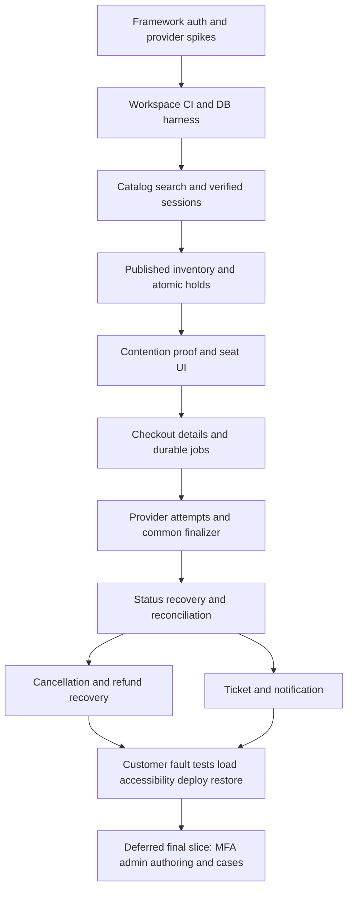

# KwikBus implementation plan

## Delivery strategy

Implementation update: Cloudflare Workers is the required backend runtime. Follow [ADR 010](../docs/decisions.md) and the updated architecture. The unpaid real-Neon/two-Workers concurrency proof, customer identity and [five P0 hardening slices](p0-hardening.md) have passed production acceptance. The [unpaid P1 catalog/search/passenger journey](../docs/p1-customer-journey.md) is now deployed and browser-verified. Next are T02 provider research and T16 durable payment jobs; T17 must enforce the remaining T15 payment-start buffer before public checkout. Public payments still require reconciliation and refund recovery. Admin is the final slice after the customer lifecycle and portfolio package. Browser usage is a required verification step for every usable slice.


Build the smallest complete system that can sell a seat correctly, then prove it can recover failures. Retain the requested TanStack Start/Express/Turborepo/Neon/Drizzle stack. Use the [PRD](../PRD.md) for scope and the [correctness protocol](../docs/booking-correctness.md) as the transaction contract.

The first technical proof is the contended hold against a real PostgreSQL database, before payment checkout or a full admin UI. The first end-to-end release candidate includes payment reconciliation and refund recovery; those are required scope, not post-launch enhancements.

**Reconciliation:** The owned-domain unpaid V0 is live. Demo data is synthetic but persisted in PostgreSQL, never client-only fixtures. The original estimates and broad phase gates below are planning history, not evidence of outstanding auth/domain setup. See the task status ledger for partial acceptance.

**Task source of truth:** [todo.md](todo.md). T01 and the workspace foundation have implementation evidence. Other items remain unchecked until their complete acceptance criteria pass; the reservation/UI slice was brought forward to prove the core risk.

## Sequence and rough effort

Estimates assume one developer familiar with TypeScript, roughly 15 focused hours/week, and available provider accounts. They include useful tests and documentation; unknown onboarding/learning time can increase them. These are planning estimates, not commitments or measured throughput.

| Phase | Outcome | Base effort | Exit gate |
|---|---|---:|---|
| 0: Feasibility | Stable-version matrix, auth/SSR proof, provider retry/recovery proof | 10–16 h | No unverified critical integration assumption |
| 1: Browse | Monorepo, CI, verified login, catalog seed, responsive search | 24–36 h | User finds a valid trip with correct URL/time handling |
| 2: Reserve | Published snapshots, constraints, atomic holds, seat UI | 28–40 h | Multi-process contention tests pass; no partial parties |
| 3: Pay safely | Durable jobs, checkout attempts, webhook finalizer, unknown-state recovery | 38–54 h | Success, duplicate, lost callback, and late capture demonstrated |
| 4: Complete lifecycle | Ticket/email, customer cancellation/refund, trip cancellation, admin exceptions | 30–44 h | Cancel/reconcile/refund paths work after crashes |
| 5: Prove and release | Accessibility, security, load, deployment, restore, portfolio evidence | 30–44 h | All release gates and recorded limitations reviewed |

Base total: **160–234 hours**. Reserve about 25% for rework/integration: approximately **200–300 hours**, or **14–20 weeks at 15 hours/week**. At 10 hours/week, allow roughly 20–30 weeks. Re-estimate after phases 0 and 2 using actual task durations.

## Dependency path



Within each slice, implement migration/contract, transaction behavior, HTTP endpoint, UI, and its proof as small linked tasks. Never complete the entire backend and leave UI integration to the end. DB migrations/shared contracts follow dependency order. UI on a frozen DTO can be developed separately from provider adapter work; this is an implementation option, not a requirement to add more developers.

## Earliest risk-reduction work

1. Pin stable compatible versions; run Start SSR and Express in Workers with a service binding and an Express-owned session. Confirm per-request cache isolation.
2. Use request-scoped Neon WebSocket/Drizzle transactions in Workers to prove interactive transactions, row locking, timeouts, and pooled/direct connection separation.
3. Prove Razorpay order creation and receipt lookup after a simulated lost response, failure-to-new-attempt behavior, capture verification, webhook validation, and same-key refund retry. Document any disagreement between guides and observed account behavior.
4. Prove Better Auth email OTP single-consumption under concurrent requests, explicit hashed storage and Google login. Verify production delivery; use the local mail adapter for CI. Admin MFA is a prerequisite of the deferred admin slice.

Stop a particular integration from advancing if its guarantee is unknown. Keep building independent catalog/UI work. Do not compensate for an uncertain provider contract with optimistic money-state assumptions.

## Proposed command interface

The README lists commands that currently exist. The full target command interface is:

```sh
pnpm install --frozen-lockfile
pnpm dev
pnpm check
pnpm build
pnpm test:unit
pnpm test:contracts
pnpm test:integration
pnpm test:contention
pnpm test:faults
pnpm test:e2e
pnpm test:a11y
pnpm db:migrate
pnpm db:seed
```

`check` should run lint, import-boundary checks, and TypeScript without emitting output. Integration suites use an isolated PostgreSQL instance; concurrency suites must support two API processes and barriers. `db:migrate` requires the designated migration URL and never infers production from a default. Fixture seeding refuses a production database. Keep secrets out of commands and output.

## Engineering conventions

- Strict TypeScript, formatter/lint rules, descriptive module-local names, discriminated domain outcomes, and explicit transaction parameters.
- Pure policy functions take relevant times/amounts as inputs; repositories execute SQL and do not silently start their own transaction.
- Example style: `canCancelBooking({ departureAt, now, policy })` returns a typed decision; an Express controller maps it to the common problem schema. Do not throw raw database/provider errors into the UI.
- Add runtime schemas at API/provider boundaries. Export DTOs only from the client-safe contracts package.
- Branch/commit each coherent slice once the repository is initialized; link its task, migration, and evidence. Do not mix unrelated refactoring with booking changes.

## Working boundaries

**Always:** preserve the PRD's inventory/payment invariants, test real SQL concurrency, commit reviewed migrations, update affected decisions/contracts, and record measured evidence with environment details.

**Review before changing:** product scope, cancellation/expiry policy, provider retry semantics, inventory granularity, public API compatibility, live infrastructure budget, and destructive schema/data changes. These decisions change the agreement, rather than being routine implementation details.

**Never:** collect card secrets, confirm from a client success flag, treat a timeout as a known failure, create another payment attempt while one is unresolved, remove a failing invariant test to ship, or describe an unmeasured target as a production result.

## Risks and practical controls

| Risk | Control |
|---|---|
| Integration/version drift | Complete spikes before scaffolding deep abstractions; pin versions and keep compatibility tests |
| Provider account unavailable | Use a fake adapter for deterministic development, but require real sandbox evidence before release |
| Scope growth from mature competitors | Hold the PRD exclusions; prioritize failure correctness over more commercial features |
| Too much infrastructure work | Keep one database and a small Worker/service-binding topology; no broker/Redis/Kubernetes prerequisite |
| Hot-trip contention | Short transactions, explicit timeouts and busy responses, measured threshold before finer locks |
| Email login friction | Verify before timed hold; preserve route/seats; test delivery and safe resend |
| Refund/unknown cases treated as optional | Make reconciliation/admin exceptions part of the release gate |
| Cloudflare or database outage | State the limitation, rehearse restore, rehearse recovery and validate provider/service objectives |

## Review checkpoints

Review the product and module boundaries before implementation; review the concurrency proof before payment work; review money-state recovery before exposing hosted checkout; review release evidence before making the public portfolio claim. Checkpoints in the backlog occur every two or three tasks, so failures stay local.

The first task to execute is T01. Do not begin with a pixel-perfect home page or a complete schema for deferred features.
